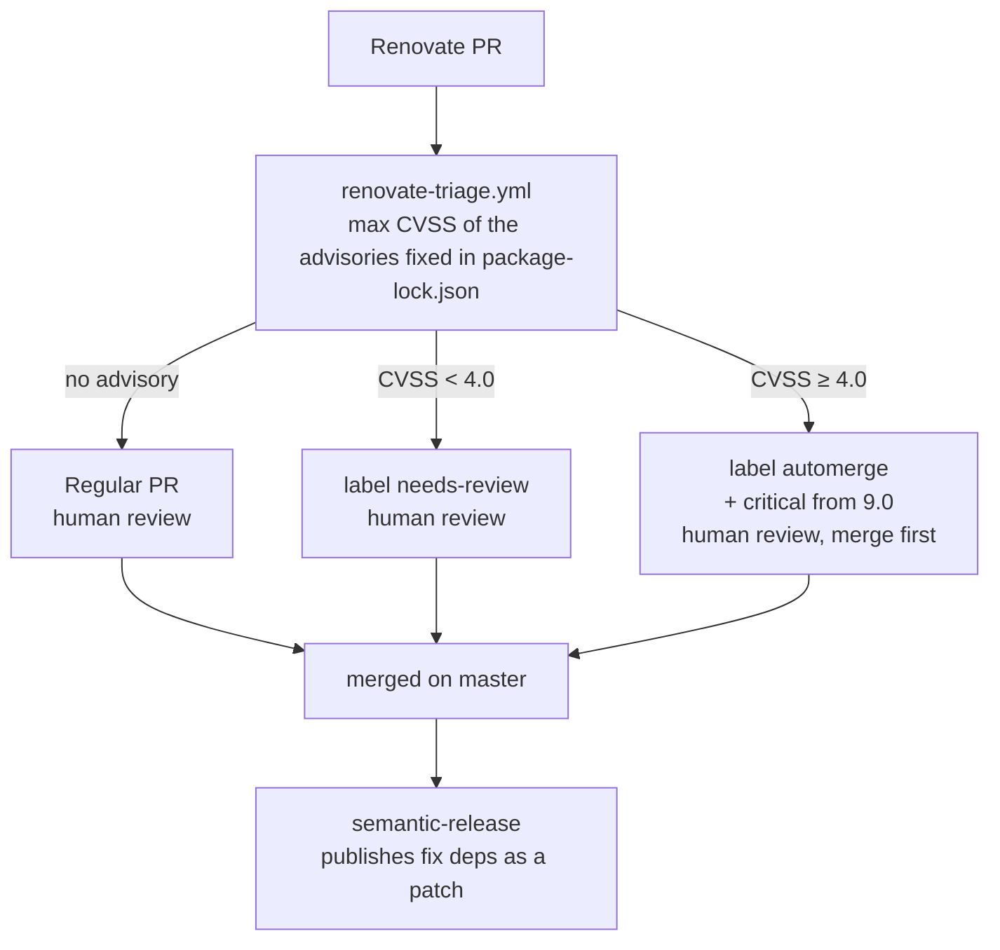

# Dependency updates (Renovate)

Dependencies are kept up to date by the hosted [Mend Renovate](https://developer.mend.io/github/algoan/eslint-config)
app, configured in [`renovate.json`](../renovate.json). It replaces the Dependabot version updates;
Dependabot alerts stay on. Security fixes are scored by the CVSS of the vulnerabilities they fix,
with the shared actions of [`algoan/renovate-security-actions`](https://github.com/algoan/renovate-security-actions),
the public counterpart of the flow `algoan/backend` runs from `algoan/private-actions`.
The **hotfix flow is off** and there is **no automerge**: see [Routing](#routing).

## What happens after a merge

Every push to `master` runs **Publish new release for @algoan/eslint-config**: `npm test`, then
semantic-release (angular preset) publishes to npmjs.com and GitHub Packages. Renovate's commits follow
the conventional format (`:semanticCommits`):

- `fix(deps): …` for the runtime `dependencies` (the ESLint plugins) releases a **patch** version;
- `chore(deps): …` (dev dependencies, lockfile maintenance, GitHub Actions) releases nothing.

So a security fix in a plugin reaches consumers as soon as it is merged. A fix that only moves
`package-lock.json` changes nothing for consumers, who resolve their own lockfile.

## What Renovate updates

| Manager          | Files                                                                                     |
| ---------------- | ----------------------------------------------------------------------------------------- |
| `npm`            | `package.json` (dependencies, peerDependencies, devDependencies, engines), `package-lock.json` |
| `github-actions` | `.github/workflows/*.yaml`, `*.yml`: actions and the `node-version` of `actions/setup-node`  |
| `custom.regex`   | `README.md`: the Requirements list, see below                                              |

The **Requirements** of `README.md` repeat the `peerDependencies` and `engines` of `package.json`. Each
line carries a hidden marker naming the dependency:

```markdown
- TypeScript `>=4.8.4`, up to `<6.1.0` <!-- renovate: datasource=npm depName=typescript -->
```

so a PR that moves the `typescript` peer range (`>=4.8.4 <6.1.0` → `>=4.8.4 <7.1.0`) moves the README
in the same PR. For TypeScript, only the upper bound carries the marker: it is the part Renovate changes.
Keep the marker when editing these lines.

Routine updates are grouped into one weekly PR (Monday before 6am, Europe/Paris); majors come on
the same schedule, one PR each. A new npm version is only proposed once it is 3 days old
(`security:minimumReleaseAgeNpm`), and `minimumReleaseAgePackageManagerSync` gives npm the same
wait, so the weekly lockfile maintenance skips younger transitive versions too.

`algoan/renovate-security-actions` updates come in their own PR (`algoan renovate-security-actions`),
for a human review: it runs the triage.

Security PRs are opened immediately at the **lowest fixing version**
(`vulnerabilityFixStrategy: lowest`), without the release-age wait. They keep the range of the
dependency and raise its floor (`rangeStrategy: bump`, e.g. `^4.17.0` → `^4.17.3`) instead of
pinning it: the package is a library, an exact version would be forced on every consumer.

## Routing



- **`renovate-triage.yml`** (`pull_request_target`) scores the packages changed in
  `package-lock.json` with the GitHub Advisory Database. The highest CVSS decides the tier. For a
  security PR it sets the `security` label plus `automerge` or `needs-review` (and `critical` from
  9.0), and comments the advisories. The PR title stays Renovate's: Renovate rewrites it, and
  recognises a PR closed on purpose by its exact title. It only runs for PRs opened by
  `renovate[bot]`, from the base commit: nothing from the PR runs with the write `GITHUB_TOKEN`,
  which matters on this public repository.
- **No automerge**: no check runs on pull requests (the only workflow runs on `master`), so there is
  nothing for `renovate-automerge` to wait for. The `automerge` label only says the fix scores 4.0 or
  more: review and merge those PRs first. Adding a `pull_request` job running `npm ci && npm test`
  would make the automerge possible (see `algoan/nestjs-components`).
- **Critical fixes (CVSS ≥ 9.0)** get the `critical` label: merge them quickly, the release follows.

Not scored by the triage: GitHub Actions advisories (such a security PR gets `needs-review` at CVSS
unknown).

## Configuration

| Repository variable        | Default | Notes                               |
| -------------------------- | ------- | ----------------------------------- |
| `CVSS_AUTOMERGE_THRESHOLD` | `4.0`   | Tier of the `automerge` label       |
| `CVSS_HOTFIX_THRESHOLD`    | `9.0`   | Unused while the hotfix flow is off |

No secret used: the action is public, called with `uses:` and pinned by commit SHA with the tag in a
comment, which Renovate's `github-actions` manager keeps up to date. Repository settings: Renovate app
installed, Dependabot alerts on.
